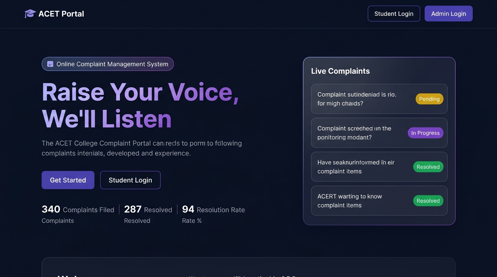
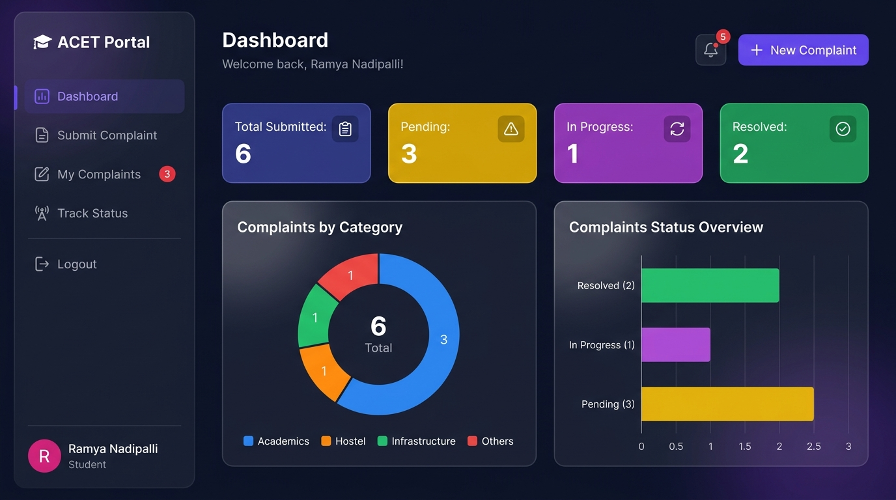

# College Complaint Management System

A web application built using Django where students can submit complaints, track their status, and get responses from the admin. The project also has a live frontend demo deployed on GitHub Pages.

**Live Demo:** https://ramya-nadipalli.github.io/College-Complaint-System/

---

## About the Project

I built this as a full-stack project to solve a real problem in college — students usually have no proper way to raise complaints and don't know what happens after. This system gives students a place to submit their complaint, pick a category, and actually see when it's been resolved or responded to.

The Django backend handles the logic and database, and I also built a standalone frontend version (HTML/CSS/JS) that can run without a server so anyone can see the working interface live.

---

## Features

- Student registration and login
- Submit complaints with category (Hostel, Academics, Infrastructure, Others)
- Track complaint status — Pending, In Progress, Resolved
- Admin dashboard to view all complaints and update their status
- Admin can write a response to each complaint
- Export all complaints as a CSV report
- Separate login pages for students and admins

---

## Tech Stack

**Backend (Django version):**
- Python 3
- Django 3.2
- SQLite (database)
- Bootstrap 5

**Frontend (Live Demo version):**
- HTML5, CSS3, JavaScript
- localStorage for data persistence
- Deployed on GitHub Pages

---

## How to Run Locally (Django Version)

```bash
# 1. Clone the repo
git clone https://github.com/ramya-nadipalli/College-Complaint-System.git
cd College-Complaint-System

# 2. Create virtual environment
python -m venv venv
venv\Scripts\activate        # Windows
# source venv/bin/activate   # Mac/Linux

# 3. Install dependencies
pip install -r requirements.txt

# 4. Run migrations
python manage.py migrate

# 5. Create admin user
python manage.py createsuperuser

# 6. Start the server
python manage.py runserver
```

Then open http://127.0.0.1:8000/ in your browser.

---

## Project Structure

```
College-Complaint-System/
│
├── Complaints/              # Main Django app
│   ├── models.py            # Complaint model
│   ├── views.py             # All views (login, register, submit, admin)
│   ├── forms.py             # Complaint form
│   ├── urls.py              # App URLs
│   └── admin.py             # Admin config
│
├── Templates/               # HTML templates
│   ├── base.html
│   ├── home.html
│   ├── login.html
│   ├── register.html
│   ├── submit_complaint.html
│   ├── view_complaints.html
│   ├── admin_dashboard.html
│   └── admin_view.html
│
├── static/                  # CSS and JS files
├── college_portal/          # Django project settings
├── manage.py
├── requirements.txt
│
│ -- Live Frontend Demo (GitHub Pages) --
├── index.html               # Landing page
├── dashboard.html           # Student dashboard
├── admin-dashboard.html     # Admin panel
├── style.css                # Stylesheet
├── main.js                  # Utilities
└── data.js                  # Data layer
```

---

## Demo Credentials (Live Version)

| Role | Username | Password |
|------|----------|----------|
| Student | student1 | student123 |
| Admin | admin | admin123 |

---

## Screenshots

**Home Page**


**Student Dashboard**


---

## What I Learned

- How to build a full-stack web application using Django
- Working with Django's built-in authentication system
- Model relationships and database queries
- How to separate admin and student roles in the same application
- Deploying a static frontend to GitHub Pages

---

## Developer

Ramya Nadipalli
- GitHub: https://github.com/ramya-nadipalli
- Email: sriramyanadipalli@gmail.com
